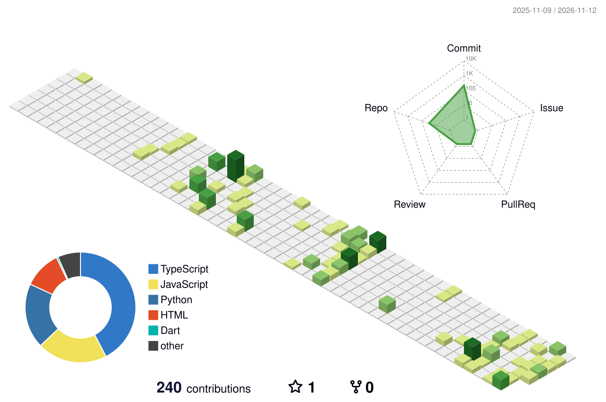

<div align="center">

<!-- Animated terminal-style typing name -->
<a href="https://github.com/arushsh">
  
</a>

</div>

```text
 █████╗ ██████╗ ██╗   ██╗███████╗██╗  ██╗
██╔══██╗██╔══██╗██║   ██║██╔════╝██║  ██║
███████║██████╔╝██║   ██║███████╗███████║
██╔══██║██╔══██╗██║   ██║╚════██║██╔══██║
██║  ██║██║  ██║╚██████╔╝███████║██║  ██║
╚═╝  ╚═╝╚═╝  ╚═╝ ╚═════╝ ╚══════╝╚═╝  ╚═╝
```

```bash
arush@github:~$ whoami
Arush Vishwakarma — Frontend / Full-Stack Engineer

arush@github:~$ cat about.txt
CS undergrad (AKTU) · Django · React · Firebase
Internal Smart India Hackathon 2025 winner
Ideathon (YEP24) champion
Turns ideas into working prototypes under tight deadlines.

arush@github:~$ cat status.txt
📍 Location   : Prayagraj, India
🎯 Looking for: Internship / entry-level role
🔨 Building   : Simplify – AI-Powered Chat Application
✉️  Contact    : varush395@gmail.com

arush@github:~$ _
```

<div align="center">

[](https://github.com/arushsh)
[](mailto:varush395@gmail.com)


</div>

---

## 🏙️ My GitHub City

Every contribution is a building. The more I ship, the taller the skyline.

<div align="center">
  <picture>
    <source media="(prefers-color-scheme: dark)" srcset="./profile-3d-contrib/profile-night-rainbow.svg" />
    
  </picture>
</div>

> The city above is generated automatically by the workflow in `.github/workflows/profile-3d.yml` (see setup notes at the bottom).

---

## 🚀 Focus

| Project | What it is |
|---|---|
| **Simplify** | AI-powered chat application (current focus) |
| **AI Smart Travel Planner** | Smart India Hackathon 2025 — internal winner |
| **Ecommerce Website** | Full-stack storefront |

## 🛠️ Tech Stack

<div align="center">


</div>

## 📦 Selected Projects

<table>
<tr>
<td width="50%" valign="top">

**[rre](https://github.com/Arushsh/rre)** · `TypeScript` · ⭐ 1
<br/>A selected project from my public work.

</td>
<td width="50%" valign="top">

**[sstechengineer](https://github.com/Arushsh/sstechengineer)** · `HTML`
<br/>A selected project from my public work.

</td>
</tr>
<tr>
<td width="50%" valign="top">

**[marriage-lawn](https://github.com/Arushsh/marriage-lawn)** · `TypeScript`
<br/>A selected project from my public work.

</td>
<td width="50%" valign="top">

**[krea](https://github.com/Arushsh/krea)** · `Python`
<br/>A selected project from my public work.

</td>
</tr>
</table>

### More work

- 🏫 **School Management System** — Role-based Django app with separate dashboards for admins, teachers and students; manages student records, attendance and class schedules with full CRUD via Django ORM.
- 🩺 **Healthcare Application** — Android app for appointments and health records, using Firebase Realtime Database for storage/sync and Firebase Authentication for secure login.

## 📊 GitHub Stats

<div align="center">


</div>

## 🎓 Education

```text
2025 – Present   B.Tech, Computer Science & Engineering — AKTU Lucknow
2022 – 2025      Diploma, Computer Science & Engineering — BTEUP
2020 – 2022      Senior Secondary (XII) — CBSE
```

---

<div align="center">

```bash
arush@github:~$ echo "Let's build something worth noticing"
Let's build something worth noticing
```

<sub>I like working with people who care about craft, context, and shipping the useful version.</sub>

</div>
